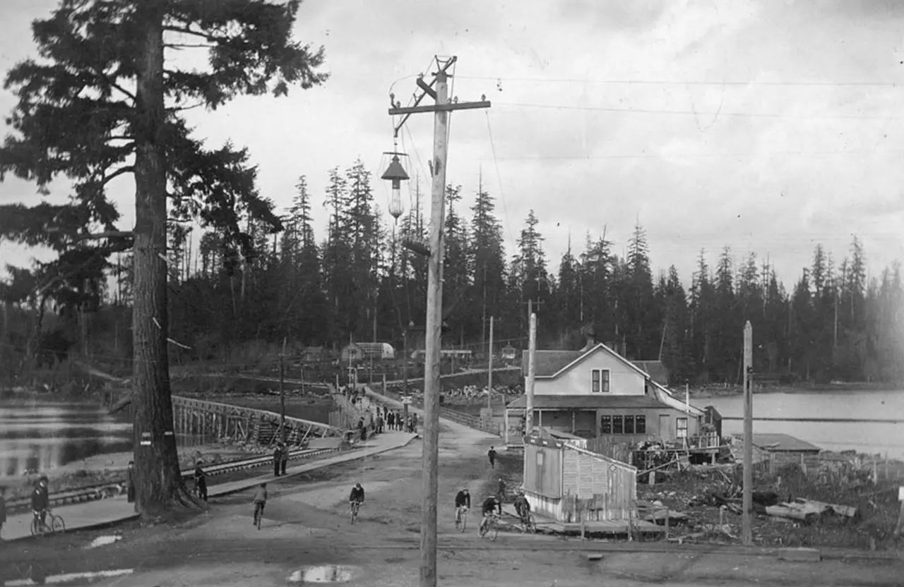
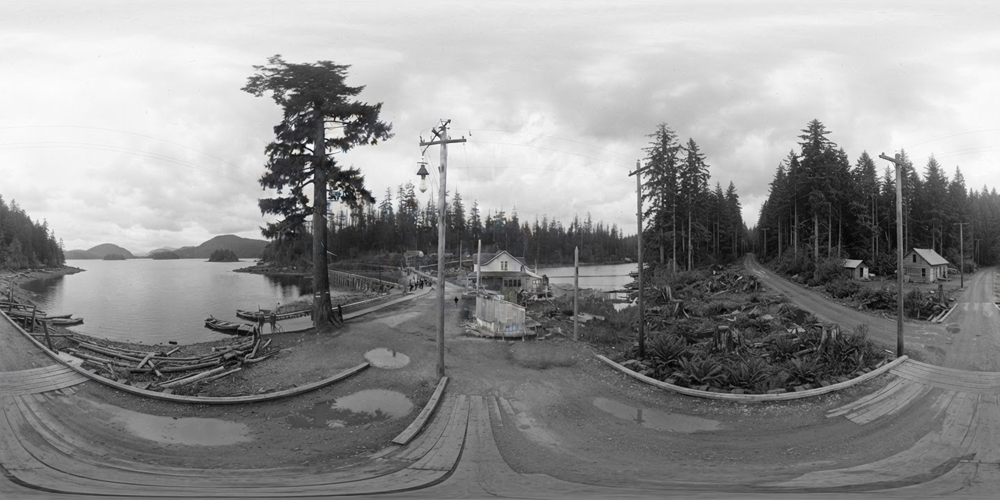
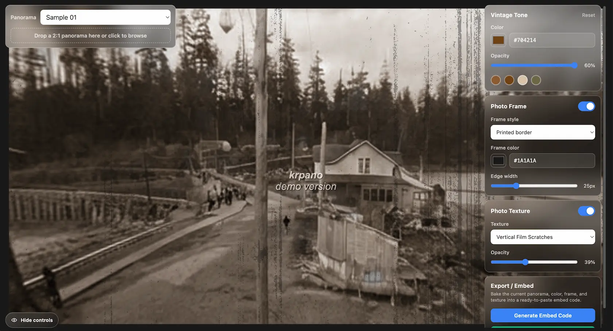

### The Goal: Create a More Immersive Experience Than a Static Picture
As part of my internship, my boss asked me to create a virtual tour using a 360-degree panoramic view. This was one of the ideas for displaying historical materials on the client's website.

<a class="blog-demo-link" href="https://panorama-viewer-v3-0.vercel.app/" target="_blank" rel="noopener noreferrer">
  <span>Explore the interactive 360° panorama viewer I built</span>
  <span aria-hidden="true">↗</span>
</a>

I was given several black-and-white photographs depicting Vancouver’s natural scenery, including the Fraser River, as well as the people who lived there about a hundred years ago.


*The original historical photograph used as the source image.*

<iframe
  src="/panorama/blog-03"
  title="Interactive 360-degree historical panorama"
  loading="lazy"
  allow="fullscreen; gyroscope; accelerometer"
  allowfullscreen
  style="display: block; width: 100%; aspect-ratio: 16 / 9; margin-top: 1rem; border: 0;"
></iframe>

### Generating the Missing Views with AI
To create a 360-degree panorama, I needed to generate the parts of the scene that the original photograph did not capture, such as the area behind the camera. This was one of the most challenging parts of the process.

It was particularly difficult because I did not know exactly where the photograph had been taken. I needed to expand the image without making the generated scenery look too generic, while keeping the entire scene visually consistent and believable.

My process began in Figma, where I adjusted the canvas to a 2:1 aspect ratio. I then used AI to generate the missing parts of the scene.

Here is one example of a prompt I used:

```
Expand the supplied image into a complete, photorealistic 360° equirectangular panorama with an exact 2:1 aspect ratio.

Use the original image as the centered, forward-facing view and the visual source of truth. Preserve the same fixed camera position, horizon height, perspective, scale, lighting, colors, textures, grain, and style. Reconstruct the unseen surroundings conservatively as one continuous version of the same location. Do not frame, mirror, duplicate, restyle, or place the source inside another scene.

Treat the canvas as a horizontally wrapped cylinder. The far-left and far-right edges represent the same rear-facing meridian and must join exactly when placed side by side. Continue every feature crossing one edge immediately through the opposite edge at the same height, scale, depth, color, and lighting. No visible seams, tonal shifts, repeated landmarks, abrupt gaps, or cut-off objects.

Complete the view above and below through the zenith and nadir. Keep the horizon level and blend all expansion boundaries seamlessly. The final image must function as a seamless 360° × 180° environment map, not merely an extra-wide photograph.
```

However, the prompt varied from case to case because the scene I wanted to generate depended on the original photograph.


*The completed 2:1 equirectangular image prepared for the 360-degree panorama viewer.*


### Developing a 360-degree Panorama Viewer with krpano
After generating the panorama image in Figma, I quickly developed a web application with the help of Codex.

The application works well. By providing it with a properly formatted image, I can create a 360-degree panoramic view without any issues.

### Emphasizing the Bygone Era
However, my boss advised me to make the experience more engaging and entertaining than simply turning the original photographs into panoramic views. One option was to colorize them, but this would have diminished their historical atmosphere and the distinctive character of century-old black-and-white photography.

Instead, my boss suggested adding scratches, dust, and white borders similar to those found on old portrait photographs. I then developed a feature that allows these effects to be applied to the panoramic views.

*I added a UI that lets users apply frames and visual effects to photographs and customize the presentation to suit their preferences.*


### Balancing Innovation with Historical Accuracy
While new technology allows us to create immersive experiences, there is still room to improve their accuracy and ensure that the original material is treated with respect.
When we presented the project to the clients, several of them responded positively. However, they also suggested removing or modifying certain details in the generated images. These were details that the designers and developers could not have identified on their own because they required the clients' unique historical and contextual knowledge.

This experience taught me that being proficient with AI is not enough. I believe that we also need to value collaboration and incorporate feedback from clients and others throughout the design and development process.

### References

<ul>
  <li>
    <a href="https://panorama-viewer-v3-0.vercel.app/" target="_blank" rel="noopener noreferrer">
      The interactive 360° panorama viewer I built
    </a>
  </li>
  <li>
    <a href="https://krpano.com/home/" target="_blank" rel="noopener noreferrer">
      krpano
    </a>
  </li>
</ul>
