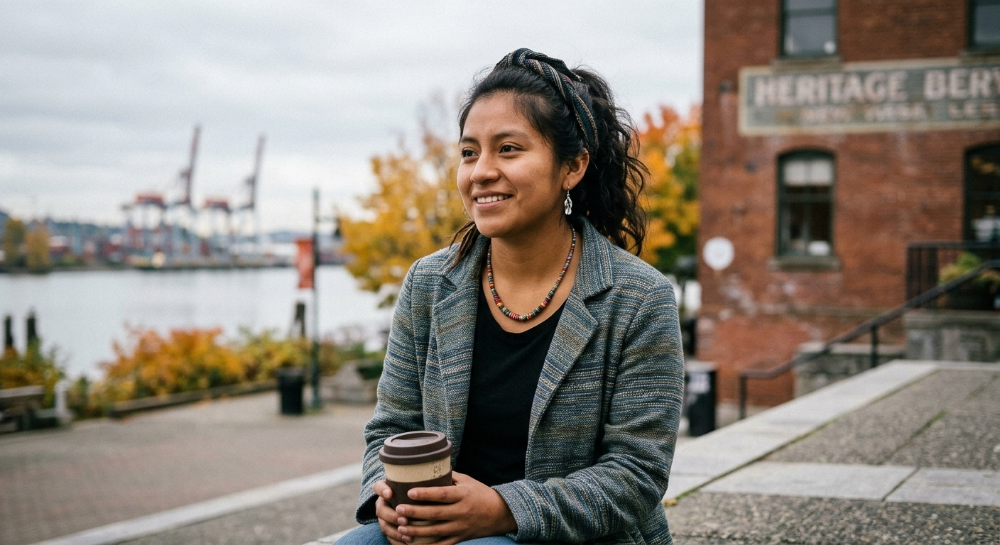
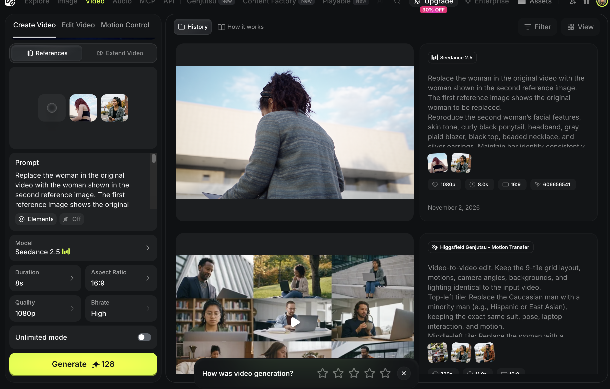

インターンシップ先で、最新の動画生成AIを使う機会がありました。今回使ったのはHiggsfieldです。使ってみた個人的な感想ですが、Higgsfieldの公式宣伝動画で見るような驚くほどの映像を、簡単な素材やプロンプトだけで生成するのは難しく、そういった動画を作るためにも作り手のクリエイティビティが求められるなと感じました。そのうえ、動画生成AIはトークンの消費も激しいです。しかし、使い方によっては、本当に痒いところに手が届くツールだと思います。

## 動画素材の人物を入れ替える

まず、Higgsfieldを使って一番役に立ったと感じたのは、動画素材の加工です。プロモーション動画を作るとき、素材サイトから条件に合う動画を短時間で見つけるのは、誰にとっても簡単ではないと思います。特にインターンシップで難しかったのは、登場人物の多様性を意識しながら、希望に合うモデルが登場する素材を探すことでした。ターゲットユーザーはバンクーバーのファースト・ネーションズの人々だったため、そうしたユーザー層を意識したモデルを探していましたが、素材サイトではなかなか見つかりませんでした。

そんなときは、Geminiで希望する人物の画像を生成し、その画像と、モデルを変更したい動画素材をHiggsfieldに渡しました。適切なプロンプトを組み合わせることで、理想に近い動画素材を得ることができました。ちなみに、プロンプトはChatGPTに作成してもらい、内容を確認・修正したうえでHiggsfieldに渡しています。

*Geminiで生成した、差し替える人物の参照画像。*

*Higgsfieldの生成画面。*

<figure>
  <video controls playsinline preload="metadata" aria-label="人物差し替え前後の比較。左がOriginal、右がSeedance 2.5による生成結果です。" style="display: block; width: 100%; height: auto; border-radius: 8px;">
    <source src="/videos/blog/06-ai-video/original-vs-seedance-2.5.mp4" type="video/mp4" />
    <a href="/videos/blog/06-ai-video/original-vs-seedance-2.5.mp4">人物差し替え前後の比較。左がOriginal、右がSeedance 2.5による生成結果です。</a>
  </video>
  <figcaption>人物差し替え前後の比較。左がOriginal、右がSeedance 2.5。</figcaption>
</figure>

## 古い写真に動きを加える

また、別のプロジェクトでは、1枚の古い歴史的な写真を徐々に現代の写真のような画質に変え、カメラが少し動くような演出を加えることで、より興味を引く映像を作るためにも使いました。

<figure>
  <video controls playsinline preload="metadata" aria-label="古い建物の写真に、色とカメラの動きを加えた作例（生成画面の録画）。" style="display: block; width: 100%; height: auto; border-radius: 8px;">
    <source src="/videos/blog/06-ai-video/historical-photo-barn.mp4" type="video/mp4" />
    <a href="/videos/blog/06-ai-video/historical-photo-barn.mp4">古い建物の写真に、色とカメラの動きを加えた作例（生成画面の録画）。</a>
  </video>
</figure>

<figure>
  <video controls playsinline preload="metadata" aria-label="歴史的な街並みの写真を使った別の作例（生成画面の録画）。" style="display: block; width: 100%; height: auto; border-radius: 8px;">
    <source src="/videos/blog/06-ai-video/historical-photo-street.mp4" type="video/mp4" />
    <a href="/videos/blog/06-ai-video/historical-photo-street.mp4">歴史的な街並みの写真を使った別の作例（生成画面の録画）。</a>
  </video>
</figure>

## 難しかったことと、素材の重要性

動画生成AIは、1枚の画像とプロンプトだけで、必ずしも期待どおりの映像を作れるわけではありません。

Higgsfieldを使ううえで一番重要だと感じたのは、素材です。理想は、場面ごとにどのような情景を描いてほしいのかが伝わる画像を、あらかじめ用意しておくことです。

例えば、リンゴの画像を1枚だけ渡して「10秒かけて金色のリンゴに変えて」と指示するよりも、元のリンゴの画像に加えて、最終的にどのような見た目にしたいのかがわかる金色のリンゴの画像も渡した方が、期待に近い結果を得やすくなります。
要するに、ストーリーボードとなる画像を準備しておくことが、動画生成の鍵だと感じました。

このように、人物を入れ替える、静止画をショートビデオにする程度なら、かなり高い精度で生成できます。しかしながら、それを「どう使うか」には、クリエイターの創造性が求められますね。
