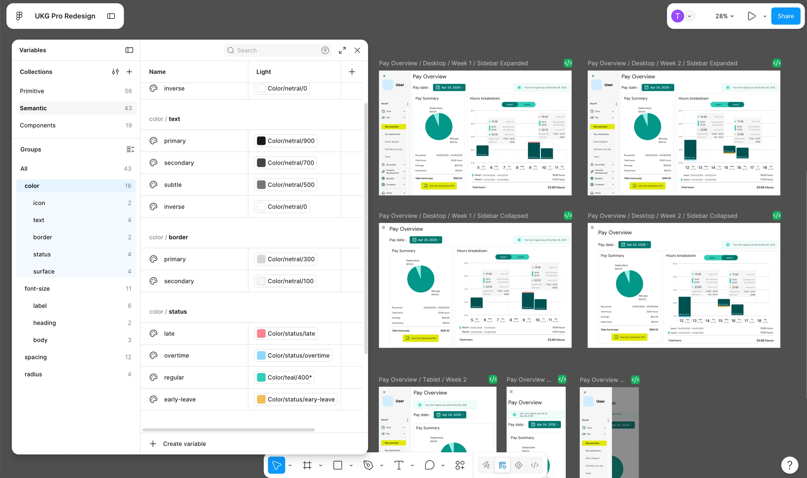
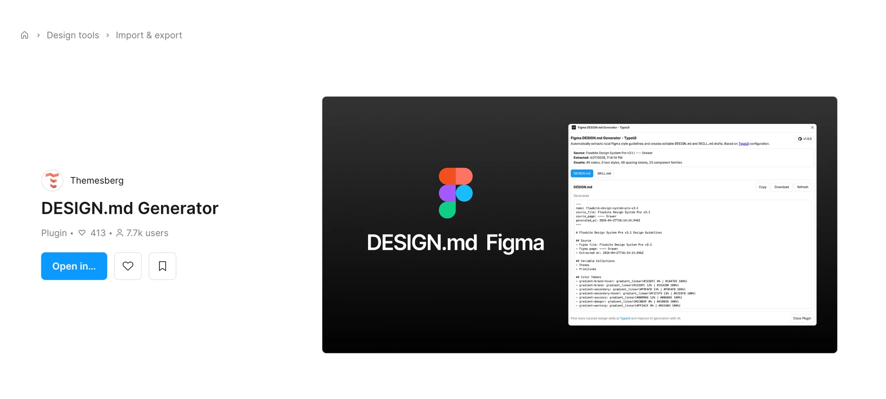
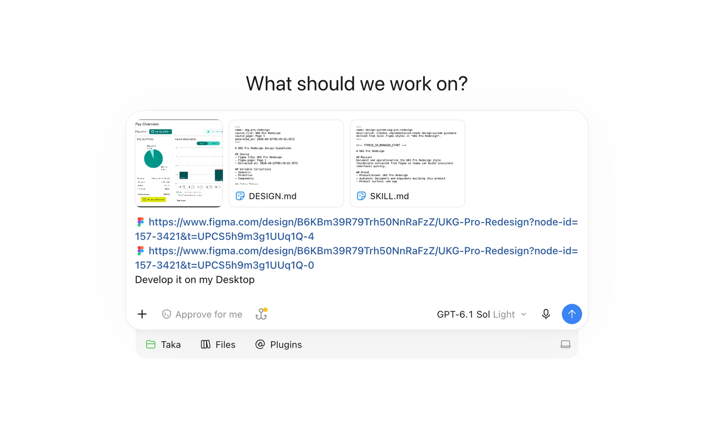
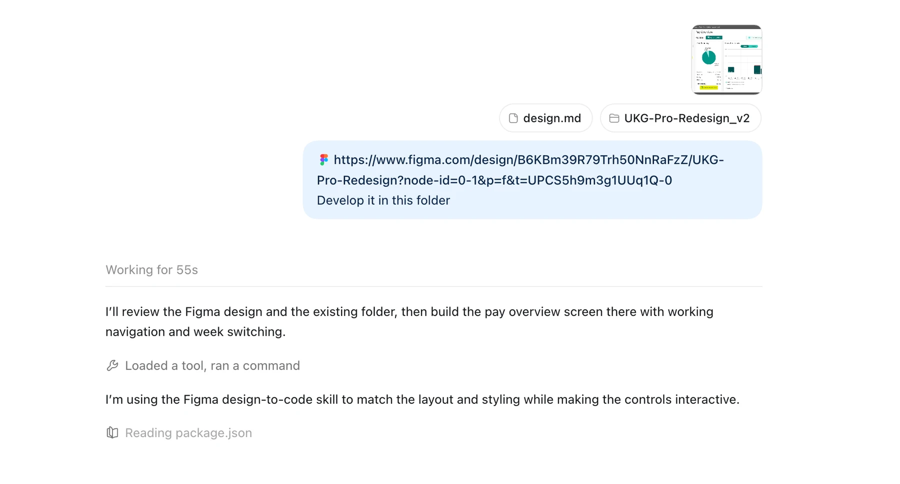

### Figmaの設計を見直す

きっかけは、以前私が作ったダッシュボードの給与確認画面を見直したことです。「ここはこうすればよかったな」とデザインの未熟さを感じ、改めてFigmaでの設計から見直すことにしました。カラートークンを見直し、spacing tokenを追加設定した上で、Frame上のデザインもできる限りtokenを使う方針です。このように設計すれば、のちにデザインの細かい変更に強くなることはもちろん、AIもFigmaのデザインを理解しやすくなるのではないかと考えています。

Design.mdを作成するにあたって使用したプラグインはこちらです。
[Figma Communityのプラグイン](https://www.figma.com/community/plugin/1612814320994608244/design-md-generator)

### v1：まずは実装

まずはCodexにFigmaのリンク、デザインの見た目の画像、そして作成したDesign.mdを渡しました。

その結果、見た目に関してはかなりの高水準で再現され、設定したspacing、color、radius、font sizeのtokenも、ちゃんと守られているように見えます。しかしsidebarを閉じた時にFigmaでデザインしていないものが現れたり、hover時の挙動は期待していたものではなかったり、responsive対応が甘かったり、UIデザインをした本人だからこそ気になる粗もいくつかありました。ただしこれらは数え切れるほどで、修正にはそこまで時間を要さないという印象です。

[v1の実装を見る](https://ukg-pay-overview-design-md.vercel.app/v1/)

### v2：仕様を詳しく

次はもっとfront end側の設計をまとめて、どういうライブラリやスタックを使うか(React + Vite, Highchartsの使用など)、カレンダーの細かい設定(高さ360pxにして１時間を15pxにするなど)などをDesign.mdにまとめて、実装を出力させました。

見た目自体は1回目とそこまで変わらず、出力に時間もかかったものの、少しだけinteractiveな部分に改善が見られます。

[v2の実装を見る](https://ukg-pay-overview-design-md.vercel.app/v2/)

### v3：AIエージェントとの対話で調整

design.mdを渡して一回で出力させる方法ではこれが限界だと感じたので、ここからはFigmaやコードを自分で編集せず、変更したい内容を普段の言葉でAIエージェントに伝えながら、見た目や挙動を調整しました。その作業には合計1時間はかかったと思います。

[v3の実装を見る](https://ukg-pay-overview-design-md.vercel.app/v3/)

### 再現度と挙動

ユーザーの操作によって見た目が変わらない静的ウェブサイトなどであれば一回のプロンプトでかなり再現度は高くなると期待でき、Figmaでデザインシステムを厳格に設計するほど、その再現度も高まるはずです。しかし今回のようなダッシュボードでは見た目だけでなく挙動も伝える必要があり、修正後の挙動も期待していたものと異なることがあるため、修正やQAには時間がかかります。ただし、front endの知識があれば、その分修正にかかる時間は抑えられると思います。

使用したDesign.mdと各バージョンの成果は、[比較サイト](https://ukg-pay-overview-design-md.vercel.app/)にまとめています。
